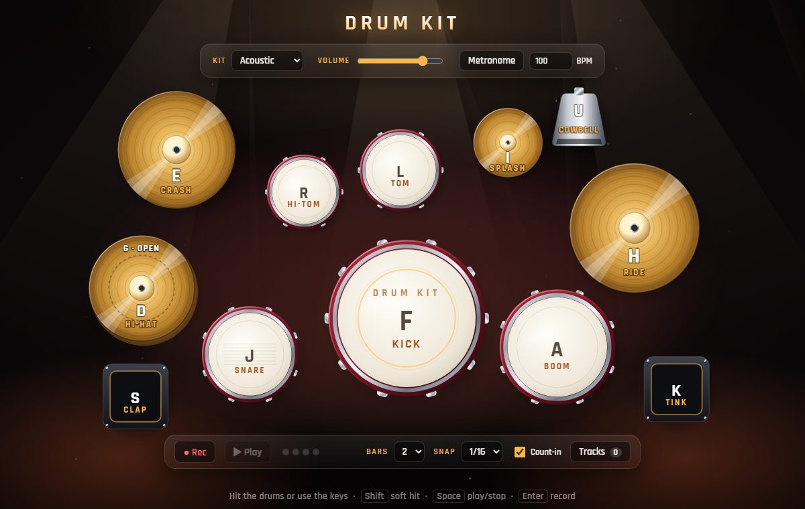

# Drum Kit

A web drum kit built with HTML, CSS and plain JavaScript. The whole kit is drawn in SVG and reacts to every hit. Play it with your keyboard, or tap the drums on a phone or tablet.



## Live Demo

[hamzi125.github.io/Drum-Kits](https://hamzi125.github.io/Drum-Kits/)

## Features

- **Animated kit:** drums glow and send out ripples, cymbals wobble, and the kick shakes the whole kit
- **13 sounds:** kick, snare, two toms, floor tom, hi-hat (closed and open), ride, crash, splash, cowbell and two electronic pads
- **Feels like a real drum:** hitting the centre of a drum is louder than the edge, and holding <kbd>Shift</kbd> plays a soft ghost note
- **Five kits, each with its own look:**
  - *Acoustic* uses recorded samples
  - *Rock Arena* is the same kit, compressed, with a huge stadium reverb
  - *Lo-Fi* is warm and dusty: saturated, tuned down, with the highs rolled off
  - *Electronic* is synthesised live with the Web Audio API
  - *Percussion* is synthesised too: conga, bongo, djembe, cowbell, agogo, gong, chimes and more
- **Multi-track looper:**
  - record up to 8 tracks on top of each other; they all loop together
  - each track keeps its own kit, so you can mix kits
  - mute, solo and volume for every track, with a timeline showing every hit
  - choose 1, 2, 4 or 8 bars, snap hits to 1/8 or 1/16 notes, and count in before recording
  - your tracks are saved in the browser
  - save the beat as a **WAV file**
- **Metronome:** 40 to 240 BPM, locked to the looper
- **Installable:** add it to your phone's home screen and it opens full screen like an app, with its own icon
- **Responsive:** the kit rearranges itself for phones (portrait and landscape), tablets and desktop. On touch screens the page stays still: no scrolling or zooming while you play

## Controls

| Key | Acoustic / Rock / Lo-Fi / Electronic | Percussion |
|-----|--------------------------------------|------------|
| A   | Floor tom (boom)                     | Conga      |
| S   | Clap                                 | Bongo      |
| D   | Hi-hat                               | Shaker     |
| F   | Kick                                 | Cowbell    |
| G   | Open hat                             | Woodblock  |
| H   | Ride                                 | Clave      |
| J   | Snare                                | Tambourine |
| K   | Tink                                 | Triangle   |
| L   | Tom                                  | Timbale    |
| E   | Crash                                | Gong       |
| R   | Hi-tom                               | Djembe     |
| U   | Cowbell                              | Agogo      |
| I   | Splash                               | Chimes     |

| Shortcut         | Action              |
|------------------|---------------------|
| <kbd>Shift</kbd> + key | soft ghost note |
| <kbd>Space</kbd> | play / stop         |
| <kbd>Enter</kbd> | start / keep a recording |

## Run locally

The acoustic samples are loaded with `fetch()`, so serve the folder over HTTP rather than opening the file directly:

```bash
python -m http.server
# then open http://localhost:8000
```

If you do open `index.html` directly, it still works: it switches to plain `<audio>` playback.

## Project structure

```
index.html   page layout and controls
style.css    styling, kit colour themes, responsive layout
kit.js       the SVG drum kit and its hit animations
script.js    audio engine, kits and effects, metronome, multi-track looper, WAV export
Sounds/      acoustic drum samples (.wav)
icons/       logo (SVG) and app icons
manifest.webmanifest   lets phones add it to the home screen like an app
favicon.ico  browser tab icon
```

## Show your support

Give a ⭐️ if you like this project!
